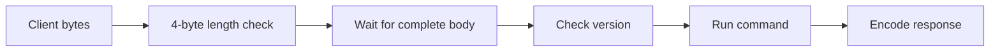

# Framed TCP Lab

A small, runnable TCP service that makes a common network programming problem visible: one application message may arrive in several socket reads, while several messages may arrive in one read. The server accepts a bounded binary frame, runs a simple command, and replies in the same format. It uses only Python's standard library.

This is an educational network service with a reproducible container build and automated checks. It is not a Marvell product, a secure public API, or a cryptographic protocol.

## Run locally

Use Python 3.12 or newer. Open two terminals from the repository root:

```text
python -m netframe.server --host 127.0.0.1 --port 9000
```

```text
python -m netframe.client PING
python -m netframe.client "UPPER hello network"
```

Expected replies are `PONG` and `HELLO NETWORK`. Port `9000` is configurable. The default address is loopback, so the service is not exposed to the local network.

Run all checks, including real loopback socket interactions:

```text
python -m unittest discover -s tests -v
```

## Wire format

| Bytes | Meaning |
|---|---|
| 0–3 | Unsigned big-endian length of the following body, including the version byte |
| 4 | Version (`1`) |
| 5 onward | ASCII command payload |

The body length must be from 1 through 65,536 bytes. `PING` returns `PONG`; `UPPER text` returns uppercase ASCII text; unknown commands return `ERR unknown-command`. A malformed length or unsupported version causes the server to close the connection. This explicit close is the lab's protocol-error policy, not a general network standard.

### Why the decoder keeps state

TCP delivers a stream of bytes, not message boundaries. If the four-byte length header arrives as two bytes and then two bytes, the first call to `FrameDecoder.feed()` saves the first two bytes and emits no frame. It reads the length only once all four header bytes exist. It then waits until that many body bytes have arrived. It can also extract two frames from one chunk. The server reads up to 4096 bytes at a time and checks the declared length before waiting for a body, so an oversized length is rejected early.



## Container demo

With Docker available:

```text
docker build -t framed-tcp-lab .
docker run --rm -p 127.0.0.1:9000:9000 framed-tcp-lab
python -m netframe.client PING
```

The image runs as a non-root user. The repository's GitHub Actions workflow runs the unit/integration suite and builds the image on pushes and pull requests. This local workstation does not currently have Docker, so its image build must be confirmed by CI or another Docker host before claiming the container ran successfully.

## Tests and failure behavior

- Header and body split across reads.
- Two requests on one connection, including coalesced bytes.
- Zero or oversized declared length; maximum allowed length.
- Unknown protocol version.
- Client disconnect halfway through a frame; server remains available.
- Unknown command returns an explicit error.

The server applies a three-second socket timeout, closes malformed connections, and logs the reason without logging request bodies. It does not authenticate clients, negotiate TLS, rate-limit peers, or impose a global connection/thread cap. Keep it on loopback or a controlled test network. Do not expose it directly to the public Internet.

## A two-weekend learning path (about eight hours of your time)

1. **Weekend 1, hour 1:** Draw the bytes in a `PING` frame. Predict the decoder state after receiving only the first two header bytes. Trace `FrameDecoder.feed()` line by line.
2. **Weekend 1, hour 2:** Change one protocol rule (for example, lower `MAX_BODY_SIZE` for a test), write the failing test first, then make it pass. Explain where the size check happens and why.
3. **Weekend 1, hours 3–4:** Run server/client, intentionally send a partial frame and an oversized header, inspect logs, and explain each result. Commit your own small improvement and push the reviewed code.
4. **Weekend 2, hours 1–2:** Read the socket tests, run them on your machine, inspect the GitHub CI run and Docker build. If Docker is available, run the container and client locally.
5. **Weekend 2, hours 3–4:** Give a 90-second project defense, then a debugging answer about partial reads, byte order, timeouts, and rejected frames. Only then finalize the CV bullet.

## What you should be able to explain

- Why `recv(4096)` can return fewer than 4096 bytes, or contain more than one logical request.
- Why the length is big-endian and why it includes the version byte.
- Why the length is checked before waiting for the rest of the frame.
- What a partial disconnect means, and why a timeout differs from EOF.
- Which parts were AI-assisted and which changes and tests you performed yourself.

### Provenance and next extension

The initial scaffold was AI-assisted on 22 October 2026. Local parser and socket tests were run by the assistant; this does not establish Aadesh's independent implementation or explanation. A useful next extension, after the above defense, is a C++ implementation of the *same documented protocol* with the Python client as a compatibility check. Add TLS only through a maintained library and test certificate failures; do not write cryptography from scratch.
